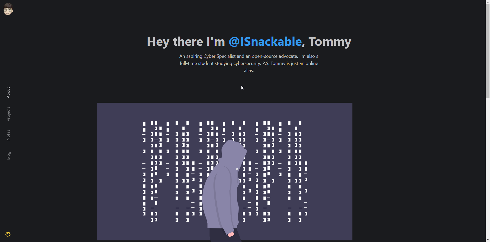

  

<h1 align="center">ISnackable Personal Site</h1>

A personal portfolio, blog, and résumé built with [Next.js](https://nextjs.org/).
Content by 
and hosting by .

## Introduction

The portfolio and embedded Sanity Studio live in `apps/web`. Edit site
identity, homepage sections, projects, posts, and résumé content in Studio.
The monorepo also includes a separate Next.js starter in `apps/app` and shared
packages for both apps.

- [Local setup, tests, and deployment](docs/development.md)
- [Editing content in Studio](docs/content-and-pages.md)
- [Reusable content modules](docs/content-modules.md)

## Authors

👤 ISnackable · [@ISnackable](https://github.com/ISnackable)

## License

Copyright © ISnackable and contributors.

Original project code is licensed under the [GNU General Public License v3.0](LICENSE).
Third-party code retains its original terms, including [next-forge](LICENSE.next-forge),
[shadcn/ui](LICENSE.shadcn), [ogimagecn](LICENSE.ogimagecn), the EasyUI notices
in the adapted components, and the [React Bits Folder](packages/design-system/components/Folder.tsx).
The collage artwork is included with permission.

## References

- Design inspired by [Yan Liu’s portfolio](https://www.awwwards.com/sites/yan-liu-portfolio).
- [next-forge](https://github.com/vercel/next-forge)
- [Sanity with Next.js](https://www.sanity.io/docs/nextjs)
